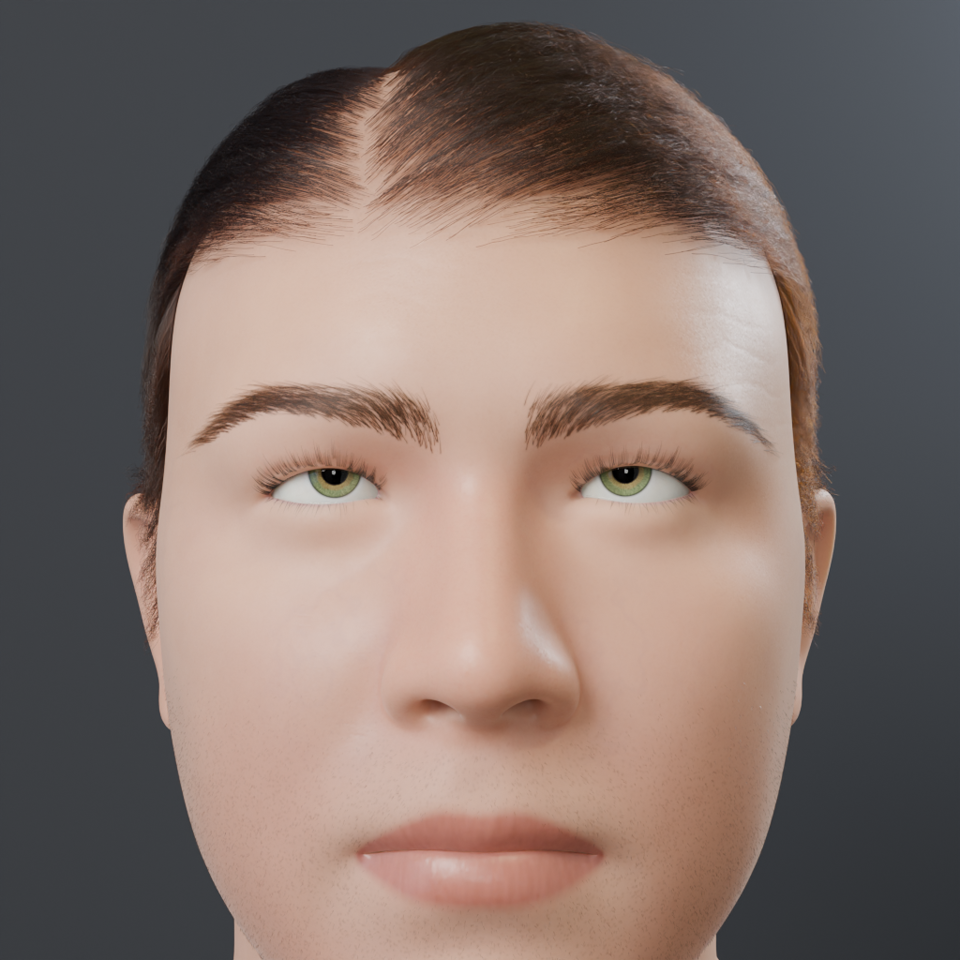

# Synthetic Eyes: Track 1 (Team Rocklef)

Team Rocklef: Sree Rohith Balaji and Thackshanaramana, SRM Institute of Science and Technology.

**Event:** Samsung PRISM Hackathon 2026 | XR Perception Group | 3D Assets Track.
*This is the event name the team uses. It has not yet been confirmed against an official organiser source.*

A photorealistic head built in Blender from Google's GNM v3 model. Both eyeballs rotate in 3D about their own centres,
converge on a fixation target 35 cm in front of the face, and are rendered by a camera locked 40 cm in front. A Python
wrapper sets the gaze and renders the frames. Each frame has a metadata record with its inputs, eye rotations, 2D pupil
centres and camera matrix.

## Demo video

[](extras/demo/SRMIST_Rocklef_demo.mp4)

| Video | Length | File |
|---|---|---|
| Demo film: problem, approach, textures, eye motion, Timeline expression, architecture, applications | 2:56 | [`extras/demo/SRMIST_Rocklef_demo.mp4`](extras/demo/SRMIST_Rocklef_demo.mp4), subtitles [`.srt`](extras/demo/SRMIST_Rocklef_demo.srt) |
| Wrapper in action: `eyes.move`, `eyes.reset`, `eyes.render`, the ten frames, the five-direction check | 1:04 | [`extras/demo/SRMIST_Rocklef_wrapper_demo.mp4`](extras/demo/SRMIST_Rocklef_wrapper_demo.mp4) |

Every scene of the demo film is also available on its own in [`extras/demo/clips/`](extras/demo/clips/).

**Note:** the demo film was rendered before the final narration wording. The current wording is in
[`extras/demo/narration.py`](extras/demo/narration.py). The wrapper video's final card reads "22 of 22 checks pass",
from an earlier checker run. See [Known limitations](#known-limitations).

## The submission zip

[`SRMIST_Rocklef.zip`](SRMIST_Rocklef.zip) is the package for the evaluators. It contains exactly the required files:
`scene.blend`, `wrapper/eyes.py`, `renders/` (ten clockwise frames), `metadata.json` and `README.md`.

The zip's `README.md` is the instruction file for someone who has only the zip: setup, the run commands, the wrapper
interface, the metadata fields and the limitations that apply to the zip. Its source is
[`extras/zip/README.md`](extras/zip/README.md). The zip is built by [`extras/tools/make_zip.py`](extras/tools/make_zip.py).

## Repository layout

The required submission files are at the top level, and everything else is under `extras/`. Each path below is a link.

| Path | Contents |
|---|---|
| [`scene.blend`](scene.blend), [`wrapper/eyes.py`](wrapper/eyes.py), [`renders/`](renders/), [`metadata.json`](metadata.json) | The submission files, the same as in the zip. |
| [`README.md`](README.md) | This file: the whole repository. |
| [`SRMIST_Rocklef.zip`](SRMIST_Rocklef.zip) | The submission zip. |
| [`AI_DISCLOSURE.md`](AI_DISCLOSURE.md) | Which AI tools were used, and for what. |
| [`LICENSE`](LICENSE) | Licence for the project's code (MIT). |
| [`Dockerfile`](Dockerfile), [`.dockerignore`](.dockerignore) | Headless build for Linux. |
| [`.github/workflows/track1-checks.yml`](.github/workflows/track1-checks.yml) | CI that runs the independent checks on every push. |
| [`extras/README.md`](extras/README.md) | Full project overview: pipeline, texture sets, rig and motion model. |
| [`extras/docs/DETAILS.md`](extras/docs/DETAILS.md) | Technical details: textures, eye motion, rig, Timeline expression, bundle build. |
| [`extras/zip/README.md`](extras/zip/README.md) | Source of the README packed inside the zip. |
| [`extras/demo/`](extras/demo/) | Demo film, wrapper video, subtitles, scene clips, poster frame. |
| [`extras/presentation/`](extras/presentation/) | Slides: [`.pptx`](extras/presentation/SRMIST_Rocklef.pptx) and [`.pdf`](extras/presentation/SRMIST_Rocklef.pdf). |
| [`extras/quality_audit/`](extras/quality_audit/) | Seam audit: numbers, UV seam overlays, and the Gate 0 report and [contact sheet](extras/quality_audit/gate0/contact_sheet.png). |
| [`extras/checks/`](extras/checks/) | Five-direction check renders and `directions.json`. |
| [`extras/renders_eyes_cli/`](extras/renders_eyes_cli/) | Eye-motion videos: [Left](extras/renders_eyes_cli/Left.mp4), [Right](extras/renders_eyes_cli/Right.mp4), [Generate Motion](extras/renders_eyes_cli/Generate_Motion.mp4). |
| [`extras/gnm_rig/`](extras/gnm_rig/) | Blender and NumPy scripts that build the rig, textures, expressions and motion. See [its README](extras/gnm_rig/README.md). |
| [`extras/textures/`](extras/textures/) | The 8 texture sets, UDIM PNG (large, about 555 MB). |
| [`extras/renders_textures/`](extras/renders_textures/) | Renders of each texture set (large, about 267 MB). |
| [`extras/tools/`](extras/tools/) | [`check_bundle.py`](extras/tools/check_bundle.py) (independent checks), [`make_zip.py`](extras/tools/make_zip.py) (packs the zip), and the demo and bundle builders. |
| [`extras/requirements.txt`](extras/requirements.txt) | Python packages for the checker and the figure scripts. |
| [`extras/eyes.py`](extras/eyes.py), [`extras/eyes_cli.py`](extras/eyes_cli.py), [`extras/render_textures.py`](extras/render_textures.py) | Entry points for the full rig: the control wrapper, the eye-motion CLI and the texture renders. |
| [`extras/gnm_expression_timeline.blend`](extras/gnm_expression_timeline.blend) | The Timeline expression. Open it in Blender and press Play. |
| [`extras/legacy/`](extras/legacy/) | Earlier MakeHuman exploration. Not part of the submission. |

## Running the project

**The submission wrapper** runs from the top level of this repository, the folder that contains `scene.blend`:

```bash
blender -b scene.blend -P wrapper/eyes.py -- --sequence      # renders/frame_00..09.png + metadata.json
blender -b scene.blend -P wrapper/eyes.py -- --directions    # checks/: center, left, right, up, down, reset
blender -b scene.blend -P wrapper/eyes.py -- --move 1 0 --out right.png
```

`--sequence` overwrites `renders/` and `metadata.json` at the top level, and `--directions` writes `checks/` there.
Use `--root DIR` to write elsewhere. Full options and the Blender Python usage are in the [zip README](extras/zip/README.md).

**The full pipeline** (rig, textures, eye motion, demo) is run from the `extras/` folder. Requirements and commands are in
[`extras/README.md`](extras/README.md) and [`extras/docs/DETAILS.md`](extras/docs/DETAILS.md). The GNM head model file is
not in the repository and is downloaded as described there.

## Verifying the outputs

From the repository top level, after `--directions`:

```bash
pip install -r extras/requirements.txt
python extras/tools/check_bundle.py .
```

The checker reads only the PNG and JSON files, never Blender. It writes `extras/quality_audit/gate0/report.md` and
`report.json`. Exit code 0 means every check passed, 2 means nothing failed but some checks could not run, and 1 means
a check failed.

Current result: **21 of 22 checks pass, 0 fail, 1 not verified.** The check that is not verified is the eye close-up
pupil check, because the close-up renders are not in this repository.

## Conventions

| Item | Value |
|---|---|
| `h`, `v` | Normalised to [-1, +1]. Values outside the range are clamped. `+h` is towards the image right (the subject's left), `+v` is up. |
| Fixation target | `M + 0.35 m forward + h × 0.05 m right + v × 0.05 m up`, where `M` is the midpoint of the two eyeball centres. |
| Camera | `CAM_Gaze`, locked 0.40 m forward of `M`, facing the face. 70 mm lens on a 36 mm sensor, 1024 × 1024. |
| Sequence | `theta_k = 2π·k/10`, `h = sin(theta_k)`, `v = cos(theta_k)`, `k = 0..9`. Starts at the top and goes clockwise. |

The full metadata field list is in the [zip README](extras/zip/README.md#metadatajson).

## Known limitations

1. **Eye close-up renders are not in this repository.** The default wrapper run writes them to `renders_eyes/`, which is
   gitignored. The metadata's `eyes_closeup` block points to those images, so the checker's close-up check is NOT VERIFIED.
   Re-rendering needs Blender: run `--sequence` without `--no-eyes`.
2. **The wrapper video's final card is out of date.** It reads "22 of 22 checks pass" from an earlier checker run. The current
   checker reports 21 of 22, with the close-up check not verified.
3. **The demo film predates the latest narration wording.** The current text is in [`extras/demo/narration.py`](extras/demo/narration.py).
   The film and its subtitles have not been regenerated.
4. **The presentation files are older than the current source.** The `.pptx` and `.pdf` were produced before the latest
   wording in [`extras/presentation/build_ppt.py`](extras/presentation/build_ppt.py). The organisers' template
   `Submission_Final_forGithub.pptx` is not in the project, so the deck cannot be rebuilt.
5. **Not run in this review:** the Blender scripts (including the wrapper), the Docker image and the CI workflow. The checker
   was run, with the result above. The rest is verified by reading the code only.
6. **Tested Blender versions:** 5.2 LTS. Blender 4.2 LTS has not been tested.

## Licences and credits

- **GNM v3 head model:** Google, Apache-2.0. Model: [huggingface.co/google/gnm-v3](https://huggingface.co/google/gnm-v3). Code: [github.com/google/GNM](https://github.com/google/GNM).
- **Studio HDRI:** Blender's bundled `interior.exr`, CC0.
- **Earlier MakeHuman work** under `extras/legacy/`: MakeHuman and MPFB assets, CC0. Not part of the submission.
- **Everything else** (textures, eyes, hair, rig, expressions, motion, wrapper, checks and renders) was written by Team Rocklef.
  See [`AI_DISCLOSURE.md`](AI_DISCLOSURE.md) for how AI tools were used.
- **Project code:** MIT, see [`LICENSE`](LICENSE).

---

**Zip package:** the instructions for running from the zip are in [`extras/zip/README.md`](extras/zip/README.md), which is the README packed inside [`SRMIST_Rocklef.zip`](SRMIST_Rocklef.zip).
