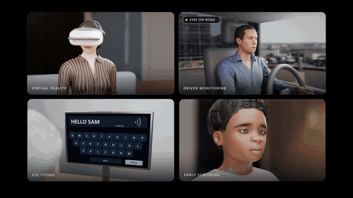
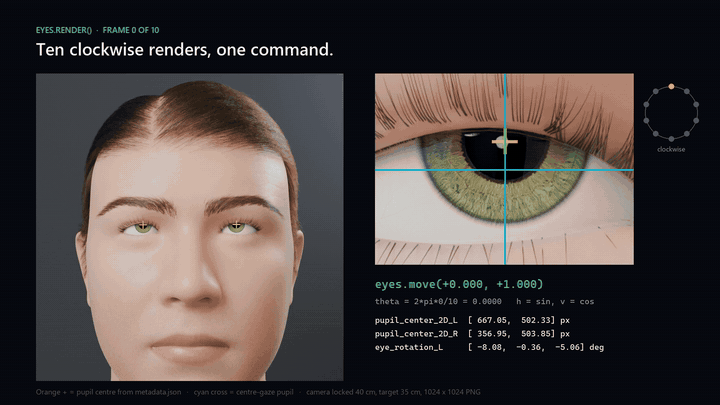
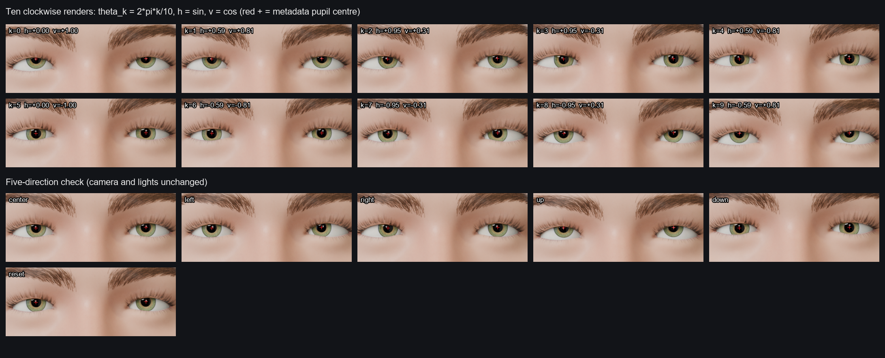

# Synthetic Eyes: Eye Movement & Virtual Camera Rendering

> Commands in this document are run from the `extras/` folder, unless a line says otherwise. Commands for the submission files itself are run from the repository top level.

**Samsung PRISM Hackathon 2026** | XR Perception Group | 3D Assets Track<br>
Team **SRMIST_Rocklef**: Sree Rohith Balaji and Thackshanaramana, SRM Institute of Science and Technology

[](https://github.com/rocklef/xr-hackathon-track1-gaze/actions/workflows/track1-checks.yml)


Photorealistic synthetic eyes built in Blender: a textured, articulatable head whose eyeballs rotate in 3D about their own centres, converge on a
fixation target 35 cm ahead, and are rendered by a camera locked 40 cm ahead, with per-frame ground truth.

## Watch

| Demo film (2:56) | Wrapper in action (1:04) |
|---|---|
| [](https://github.com/rocklef/xr-hackathon-track1-gaze/raw/main/demo/SRMIST_Rocklef_demo.mp4) | [](https://github.com/rocklef/xr-hackathon-track1-gaze/raw/main/demo/SRMIST_Rocklef_wrapper_demo.mp4) |
| [**Download the full film (MP4)**](https://github.com/rocklef/xr-hackathon-track1-gaze/raw/main/demo/SRMIST_Rocklef_demo.mp4): the problem, applications, textures, eye motion, Timeline expression, architecture and results | [**Download the wrapper demo (MP4)**](https://github.com/rocklef/xr-hackathon-track1-gaze/raw/main/demo/SRMIST_Rocklef_wrapper_demo.mp4): `eyes.move` / `eyes.reset` / `eyes.render`, the 10 clockwise frames with their metadata, the five-direction check |

The previews above play on this page; GitHub downloads MP4 files instead of playing them, so click to download the
full videos. Every scene is also available on its own in [`demo/clips/`](demo/clips/). Slides:
[`presentation/SRMIST_Rocklef.pdf`](presentation/SRMIST_Rocklef.pdf) (opens in the browser).



## Track 1 deliverables

| Required (track specification) | Where |
|---|---|
| Submission bundle `team_name.zip` | [`SRMIST_Rocklef.zip`](SRMIST_Rocklef.zip), with its contents at the repository top level |
| Complete `.blend` scene: textured mesh, eye bones, materials | [`scene.blend`](../scene.blend) |
| Python wrapper `eyes.move(h, v)` / `eyes.reset()` / `eyes.render()` | [`wrapper/eyes.py`](../wrapper/eyes.py) |
| 10 clockwise renders, θk = 2πk/10, h = sin θk, v = cos θk, starting at the top | [`renders/`](../renders/) (1024 × 1024 PNG) |
| Per-frame JSON: inputs, eye rotations, 2D pupil centres, camera matrix | [`metadata.json`](../metadata.json) |
| README with setup instructions | [`README.md`](../README.md) and this file |
| Contact sheet or 1-2 min demo video | contact sheet [`quality_audit/gate0/contact_sheet.png`](quality_audit/gate0/contact_sheet.png); 1:04 wrapper video [`demo/SRMIST_Rocklef_wrapper_demo.mp4`](demo/SRMIST_Rocklef_wrapper_demo.mp4) (made by [`tools/wrapper_demo.py`](tools/wrapper_demo.py) from the bundle's own output) |

### Measured against the evaluation (100 points)

All numbers come from [`tools/check_bundle.py`](tools/check_bundle.py), which reads only the rendered PNGs and the JSON
(report: [`quality_audit/gate0/report.md`](quality_audit/gate0/report.md): 21 of 22 checks pass; the eye close-up check is NOT VERIFIED because its renders are not in the checkout; the same checks re-run on GitHub at every push, see the badge above).

| Criterion | Points | Result |
|---|---|---|
| **Direction pass/fail** | 40 | **5 of 5.** Left, Right, Up and Down each move both detected pupils 9-10 px in the 1024 frame; Reset is identical to centre |
| **Calibration** | 20 | Fixation target 0.350 m forward of the eye midpoint (motion bound ±5 cm); camera locked 0.400 m forward, its axis through the eye midpoint; both lines of sight hit the target within 0.0001° |
| **Automation** | 20 | One command per task, headless; runs from a clean unzip on Blender 5.2.4 and 5.3.0 with identical metadata |
| **Sequence & metadata** | 20 | 10 frames in clockwise order, 1024 × 1024 PNG, constant lighting; every required metadata field present; metadata pupil centres within 1.92 px of the pupils detected in the images |

## Run it

Needs only Blender 5.2 LTS (or newer). From the repository top level (or the unzipped `SRMIST_Rocklef.zip`):

```bash
blender -b scene.blend -P wrapper/eyes.py -- --sequence      # renders/frame_00..09.png + metadata.json
blender -b scene.blend -P wrapper/eyes.py -- --directions    # checks/: center, left, right, up, down, reset
blender -b scene.blend -P wrapper/eyes.py -- --move 1 0 --out right.png
```

Inside Blender (Scripting tab, with `scene.blend` open):

```python
import sys; sys.path.append(r"<repo folder>/wrapper")
import eyes
eyes.move(0.5, -1.0)            # h, v in [-1, +1]; +h = image right, +v = up
rec = eyes.render("test.png")    # 1024 x 1024 PNG + its metadata record
eyes.reset()
```

Check any output independently: `pip install -r extras/requirements.txt`, then `python extras/tools/check_bundle.py .`.
If Cycles fails on an older NVIDIA driver, set `XR_CYCLES_DEVICE=CUDA`.

**Docker** (Linux, nothing else to install):

```bash
docker build -t rocklef-gaze .
docker run --rm -v "$PWD/out:/out" rocklef-gaze        # renders the 10 frames + checks, copies them to ./out
```

## Additional features

Beyond the required output, the head is built for photorealism:

- **8 photorealistic texture sets** on the head's UV layout (skin, separate left and right irises, teeth), seam-free by
  construction: [`textures/`](textures/), renders in [`renders_textures/`](renders_textures/), seam audit in
  [`quality_audit/`](quality_audit/README.md).
- **3D hair**: head hair, brows, lashes, stubble and fine facial hair, all bound so nothing drags across the eye.
- **Natural eye motion** with saccades, fixation drift, blinks and lids that follow the gaze:
  [`eyes_cli.py`](eyes_cli.py) renders the inputs Left, Right and Generate Motion to
  [`renders_eyes_cli/`](renders_eyes_cli/).
- **An expression on the Blender Timeline**: [`gnm_expression_timeline.blend`](gnm_expression_timeline.blend)
  (eyelids, pupils, brows and gaze; open it and press Play).
- **A richer control wrapper** for the full rig: [`eyes.py`](eyes.py) (gaze, eyelids, blinks, pupils, brows and
  20 identity sliders).
- **Application scenes** where synthetic eyes matter, rendered in Blender with the same eye rig:
  VR foveated rendering, driver monitoring, eye typing and early autism screening.

Every scene of the demo is also available as its own clip in [`demo/clips/`](demo/clips/):

| Clip | Shows |
|---|---|
| [`app_vr.mp4`](demo/clips/app_vr.mp4) | Virtual reality: a headset sharpens only where the user looks |
| [`app_car.mp4`](demo/clips/app_car.mp4) | Driver monitoring: the car warns when the driver's eyes leave the road |
| [`app_access.mp4`](demo/clips/app_access.mp4) | Eye typing: a person who can't speak types "HELLO SAM" with their eyes |
| [`app_medical.mp4`](demo/clips/app_medical.mp4) | Early screening: a child's gaze on a screen game |
| [`orbit.mp4`](demo/clips/orbit.mp4) | The textured head with hair, turning in studio light |
| [`identity.mp4`](demo/clips/identity.mp4) | Face-shape sliders changing the face while the eyes stay seated |
| [`timeline.mp4`](demo/clips/timeline.mp4) | The Timeline expression: surprise, squint, eye-roll, blink |

How everything is built: [`docs/DETAILS.md`](docs/DETAILS.md).

## Submission checklist

| Item | Where |
|---|---|
| Submission package (as specified by the track) | [`SRMIST_Rocklef.zip`](SRMIST_Rocklef.zip) |
| Source code | [`wrapper/`](../wrapper/), [`tools/`](tools/), [`gnm_rig/`](gnm_rig/), [`eyes_cli.py`](eyes_cli.py), [`eyes.py`](eyes.py), [`render_textures.py`](render_textures.py) |
| Presentation | [`presentation/SRMIST_Rocklef.pdf`](presentation/SRMIST_Rocklef.pdf) (view in browser) and [`.pptx`](presentation/SRMIST_Rocklef.pptx) |
| Video | demo film [`demo/SRMIST_Rocklef_demo.mp4`](demo/SRMIST_Rocklef_demo.mp4) (2:56); wrapper demo [`demo/SRMIST_Rocklef_wrapper_demo.mp4`](demo/SRMIST_Rocklef_wrapper_demo.mp4) (1:04); every scene in [`demo/clips/`](demo/clips/) |
| AI disclosure | [`AI_DISCLOSURE.md`](../AI_DISCLOSURE.md) |
| README | this file, [`README.md`](../README.md), [`docs/DETAILS.md`](docs/DETAILS.md) |
| Docker, requirements, licence, CI | [`Dockerfile`](../Dockerfile), [`requirements.txt`](requirements.txt), [`LICENSE`](../LICENSE) (MIT), [`.github/workflows/track1-checks.yml`](../.github/workflows/track1-checks.yml) |
| APK / SDK | not applicable (no app); the Python wrapper is the programmable interface |

## Credits and licences

- Base head mesh, identity decoder and UV layout: Google GNM v3, Apache-2.0 ([github.com/google/GNM](https://github.com/google/GNM)). Everything else (textures, eyes, hair, rig, expressions, motion, wrapper, verification, renders) was built by Team Rocklef.
- All textures, rig, expressions, motion and rendering code here were written for this submission.
- Studio lighting HDRI: Blender's bundled `interior.exr` (CC0).
